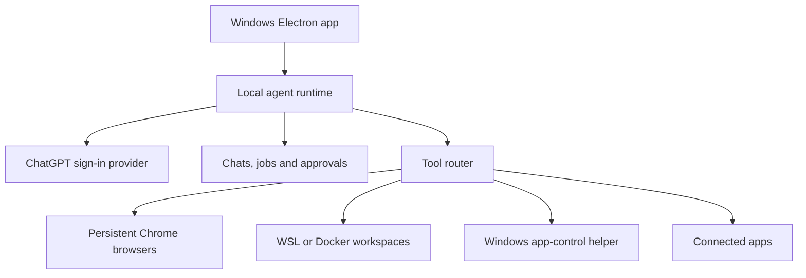

# Plan Windows WSL Version

**Created:** 10/15/2026 16:09:17
**Updated:** 10/16/2026 8:20:56
**Exported:** 10/16/2026 8:23:29
**Link:** [https://chatgpt.com/g/g-p-6aac315d34b88191a8d7cc529a7f94f8-g-chat-2/c/6ad140ea-1764-83ea-b4b6-a924bb430405](https://chatgpt.com/g/g-p-6aac315d34b88191a8d7cc529a7f94f8-g-chat-2/c/6ad140ea-1764-83ea-b4b6-a924bb430405)

## Prompt:
10/15/2026, 4:09:12 PM

[[PAO:chatgpt-token:016221cfc94422759a3fed3a682b2236c898d649]]

since we're on plus lets work on creating our own version of dots using the following:

[https://github.com/AcidicSoil/open-dot](https://github.com/AcidicSoil/open-dot)

---

it's meant for mac so let's map out how we can make the changes for a fully functional windows/wsl version

## Response:
10/15/2026, 4:09:18 PM · gpt-6-astra-wm

I’ll inspect the repository and map its macOS dependencies to Windows and WSL options, then lay out an implementation plan with the main compatibility risks.

The core is already Next.js and Electron, so most of the app can stay. The main porting work is the desktop launcher, credential storage, shell execution, packaging, and native app control.

One key distinction: this repository uses API keys; it does not currently use a Plus sign-in. I’m checking the supported subscription route before treating Plus as its model backend. Its macOS native control also depends on private ChatGPT components, so Windows needs a separate implementation.

Your local instruction path is unavailable in this environment. I read the repository’s `AGENTS.md`; Engram had no relevant Open Dot decision, and no Hindsight capability was available.

There is a documented Plus route: OpenAI now supports “Sign in with ChatGPT” for eligible requests from open-source apps. That fits this fork’s existing Responses API loop, so we may be able to keep the agent engine and add authentication plus local conversation history.

I also found two gaps in the repository: its Sky native-control module is detected but never connected to the agent’s tools, and E2B alone cannot keep the agent thinking while your PC sleeps—the agent loop and scheduler still run locally. Both affect what we should call “fully functional.”

**Yes. We can build this as a Windows desktop app with WSL execution support while keeping most of Open Dot’s existing interface and agent logic.** The largest changes are authentication, background operation, Windows integration, and reliable execution boundaries.

I inspected your fork at commit [`f838e17`](https://github.com/AcidicSoil/open-dot/tree/f838e17cf5c3a88ade5ceea54680a8145d048c1d). This is a source-based plan; I have not run it on your Windows machine or changed the repository.

**Working assumptions**

- Windows 11 is the main desktop target.
- WSL2 provides Linux tools and workspaces.
- Your Plus subscription is the preferred model access method.
- “Fully functional” includes persistent browsers, approvals, schedules, integrations, files, and Windows app control.

**1. Use Plus through supported ChatGPT sign-in**

OpenAI now documents a **Sign in with ChatGPT flow for open-source apps**, allowing eligible Plus and Pro accounts to authorize inference through their plan. Open Dot currently supports API keys only, so we need to add this. Account eligibility and a completed request must be verified during implementation. ([developers.openai.com](https://developers.openai.com/siwc/quickstart?utm_source=chatgpt.com))

The simplest approach is to keep Open Dot’s Responses API agent loop and add a ChatGPT authentication provider.

| Change | Why it is needed |
|---|---|
| Add browser sign-in, PKCE, token refresh, and sign-out | Establish and maintain authorized Plus access |
| Add account-specific model discovery | The subscription model catalog differs from the existing API-key response |
| Store conversation history locally | This flow requires `store: false` |
| Stream every inference request | This flow requires `stream: true`, including helper requests |
| Handle usage limits and interrupted streams | Receiving some text does not prove a request completed |
| Separate provider capabilities from history handling | Existing `stateless` logic also selects OpenRouter-specific behavior |

These changes affect `agent/client.ts`, `agent/runtime.ts`, `agent/review.ts`, `titles.ts`, and Settings. OpenAI documents the public Responses endpoint, local history requirements, and terminal-event handling. ([developers.openai.com](https://developers.openai.com/siwc/token-sharing-open-source/models-and-inference?utm_source=chatgpt.com))

**Voice remains a separate compatibility check.** The existing implementation calls OpenAI Realtime. The verified subscription documentation above establishes Responses access; it does not establish Realtime coverage. We should preserve voice as an explicit provider option, with no automatic paid fallback.

**2. Recommended Windows/WSL architecture**

Run Electron and the main application server on Windows. Use WSL for Linux execution through an explicit adapter.

This keeps Windows credentials, notifications, browser processes, and native app control together. WSL becomes a selected execution target rather than an implicit dependency everywhere.

For WSL development, the same server can run inside Linux and be opened from Windows. Network discovery must account for NAT versus mirrored networking; cross-boundary `localhost` behavior is not identical in both modes. ([learn.microsoft.com](https://learn.microsoft.com/en-us/windows/wsl/networking?utm_source=chatgpt.com))

**3. Concrete porting map**

| Area | What the repository does now | Required change |
|---|---|---|
| **Desktop lifecycle** | Closing the window keeps running only on macOS | Windows tray with Open, Pause, and Quit; optional startup at sign-in |
| **Launcher and PATH** | Launches a login shell, defaults to `/bin/zsh`, uses Unix PATH separators | Platform-specific environment discovery; explicit WSL distro selection |
| **Build scripts** | Uses `cp`, `find`, Unix environment assignment, and `--mac` | Node-based file operations, portable launch script, Windows installer target |
| **Secrets** | macOS Keychain; otherwise an on-disk master key | Windows-protected key storage, with migration of existing encrypted data |
| **Shell execution** | Calls `bash` directly | Explicit `windows`, `wsl`, and `docker` targets with correct working directories and cancellation |
| **Browser lifecycle** | Playwright profiles plus Unix-style lock cleanup | Windows process ownership and recovery; verify restart, login persistence, and takeover |
| **Files** | Mixes physical paths and `/workspace` paths | Keep logical workspace paths distinct from Windows, WSL, and container paths |
| **Native applications** | Contains a private macOS Sky adapter | Add a Windows helper and connect it to the tool registry |
| **Scheduling** | In-process cron jobs | Persist due runs, retry state, timezone, and missed-run policy |
| **Interface** | “This Mac,” Keychain descriptions, macOS assumptions | Show actual platform, execution target, and available capabilities |

Primary files: [desktop launcher](https://github.com/AcidicSoil/open-dot/blob/main/electron/main.mjs), [packaging](https://github.com/AcidicSoil/open-dot/blob/main/scripts/desktop-prepare.mjs), [shell execution](https://github.com/AcidicSoil/open-dot/blob/main/src/server/computer/shell.ts), [vault](https://github.com/AcidicSoil/open-dot/blob/main/src/server/vault.ts), and [browser](https://github.com/AcidicSoil/open-dot/blob/main/src/server/computer/browser.ts).

For credentials, Electron’s `safeStorage` uses Windows DPAPI. Because the Next.js backend runs in a separate process, we need a narrow credential bridge to Electron rather than importing Electron storage APIs into the server. ([electronjs.org](https://www.electronjs.org/docs/latest/api/safe-storage?utm_source=chatgpt.com))

**4. Native Windows control needs real implementation**

The repository’s [`sky.ts`](https://github.com/AcidicSoil/open-dot/blob/main/src/server/computer/sky.ts) launches private components from the macOS ChatGPT installation. More importantly, its execution functions are **not wired into the current agent tools**. Installation detection alone does not provide native app control.

Our Windows helper should expose:

- Application and window discovery.
- UI element inspection.
- Click, invoke, type, select, and scroll operations.
- Screenshots and coordinate fallback.
- Per-app permission checks and immediate cancellation.

Microsoft UI Automation provides the underlying interface for inspecting and manipulating supported Windows controls. Screenshot-based interaction covers cases where applications expose insufficient UI information. ([learn.microsoft.com](https://learn.microsoft.com/en-us/windows/win32/winauto/uiauto-uiautomationoverview?utm_source=chatgpt.com))

Native actions should pass through the existing approval system. We also need one shared desktop-action queue so two dots cannot compete for focus or keyboard input.

**5. Fix these execution gaps during the port**

These are visible in the current code:

- **Docker can silently fall back to host Bash.** Pin the execution target for each run. If its container becomes unavailable, stop instead of changing environments.
- **A workspace folder is not a sandbox.** WSL host commands must remain distinct from isolated container commands.
- **Path containment uses a string prefix check.** Replace it with proper containment checks, including symlink handling.
- **E2B does not move the agent loop off your PC.** Its remote computer can exist independently, but local scheduling and model calls stop when the host sleeps.

For the first Windows release, background operation should mean **running while Windows is awake, even with the window closed**. Truly continuous operation requires moving the scheduler and agent worker to an always-on host.

**6. Implementation order and completion gates**

| Stage | Deliverable | Evidence required |
|---|---|---|
| **1. Plus authentication** | ChatGPT provider integrated with the existing loop | Sign in, complete a tool round-trip, refresh credentials, continue a conversation |
| **2. Windows application** | Installable app, tray lifecycle, protected secrets | Install and launch without development tools; close and reopen without losing work |
| **3. WSL execution** | Distro selection, workspace mapping, reliable cancellation | Run commands, exchange files, cancel descendants, recover from WSL shutdown |
| **4. Browser and integrations** | Persistent browser, takeover, OAuth, approvals | Logins survive restart; deny prevents execution; takeover pauses agent input |
| **5. Background reliability** | Durable jobs and recovery | Restart during work; resume safely; handle missed schedules without duplicate actions |
| **6. Native Windows control** | Working Windows helper | Inspect and operate representative apps; verify focus, DPI, permissions, and stop behavior |
| **7. Voice and release parity** | Verified voice provider and final packaging | Microphone permissions, task handoff, upgrade persistence, clean shutdown |

**Start with Stage 1: prove Plus-backed inference and one approved browser action.** That validates the central dependency before spending time on packaging or native desktop control. Verification can use direct runtime checks; this plan does not require adding test files.

---

**Sources:**

- [Quickstart – Sign in with ChatGPT](https://developers.openai.com/siwc/quickstart?utm_source=chatgpt.com)
- [Accessing network applications with WSL](https://learn.microsoft.com/en-us/windows/wsl/networking?utm_source=chatgpt.com)
- [safeStorage](https://www.electronjs.org/docs/latest/api/safe-storage?utm_source=chatgpt.com)

## Prompt:
10/15/2026, 4:17:13 PM

[$matt-skills-curated](app://plugins_6a78e83987748191afc0c56e12172fce) to-spec

## Response:
10/15/2026, 4:16:53 PM · gpt-6-astra-wm

I’ll use the plugin’s to-spec skill to turn the Windows/WSL plan into an implementation specification.

The spec will keep Windows as the desktop host and WSL as an explicit execution target. It will distinguish required behavior from compatibility checks, especially Plus tool support and voice. I’ll include acceptance gates and preserve your rule against creating new test files without approval.

Created [open-dot-windows-wsl-spec.md](sandbox:/workspace/scratch/28520ebb0339/.scratch/open-dot-windows-wsl/open-dot-windows-wsl-spec.md).

Includes 30 user stories, architecture and data contracts, file-level changes, seven delivery stages, acceptance criteria, and explicit scope boundaries.

**First implementation gate:** Plus sign-in and a completed browser/tool round-trip. New test files remain opt-in.

## Prompt:
10/15/2026, 4:43:36 PM

how should we begin?

## Prompt:
10/15/2026, 4:46:15 PM

What would you like me to do with the Windows/WSL specification?

1
Implement Stage 1, subscription sign-in and inference

2
Review the specification against the current code

3
Create an implementation plan for all stages

## Response:
10/15/2026, 4:45:40 PM · gpt-6-astra-wm

Choose **1 — Implement Stage 1, subscription sign-in and inference**.

Have the agent inspect the current code first, then implement and verify the complete sign-in → browser/tool action → response flow.
